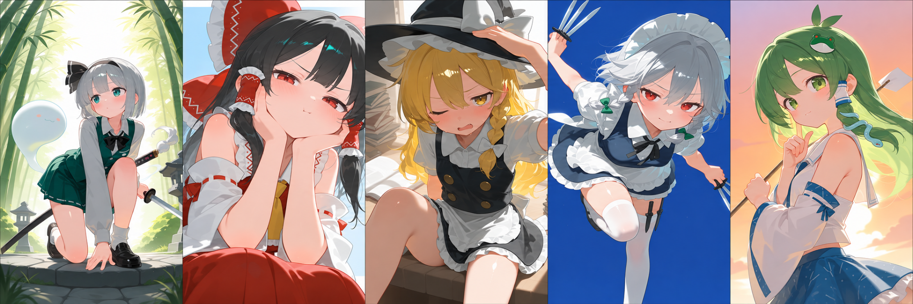

# Stable Diffusion Anime Style Lab

**Myon_style · NeoForge SDXL Configuration & Visual Experiments**

A personal anime-style image generation project built around **Stable Diffusion WebUI NeoForge** and the **WAI-illustrious-SDX / Illustrious SDXL** model family. The focus is a clearly documented **generation configuration** for a consistent anime style.

> **Scope:** This repository documents a personal generation setup and visual experiments. It does not claim a new diffusion algorithm or a visually evaluated, released model.

## 1. Myon_style — Visual Goal

**Myon_style** is the name I use for my preferred visual style: **cute anime portraits, soft cel shading, clean line art, expressive faces, and minimal graphic backgrounds**. I prioritize the character's face, silhouette, and cohesive shading over complex scenery.

  

The visual style is produced using a Signature Style Preset combining artist-style tags and a LoRA. Detailed settings are documented in `style/signature-style.txt`.

**Naming distinction:** `Myon_style` names my visual style. A separate personal **Myonstyle_v1 LoRA** completed its first formal training on 2026-11-05; preliminary visual comparisons are underway. It is **not** the LoRA used to produce the published examples.

## 2. NeoForge SDXL Configuration

| Setting | Current / recommended configuration |
| --- | --- |
| Interface | **Stable Diffusion WebUI NeoForge** |
| Checkpoint family | **WAI-illustrious-SDX / WAI-Illustrious (SDXL-based)** |
| Model compatibility | **WAI-Illustrious versions above 15.0** can be used |
| VAE | VAE configuration provided by the checkpoint |
| Base portrait resolution | **896 × 1152** |
| Sampler / Scheduler | **Kohaku LoNyu Yog / Karras** |
| Sampling steps | **15–30 recommended** |
| CFG scale | **Around 4.5 recommended; 3.5 personally preferred** |
| Prompt style | Six functional blocks separated with `BREAK` |
| Existing style LoRA | **nyalia**, weight `0.6` (not the separately trained Myonstyle_v1 LoRA) |
| ADetailer / Hires.fix | Optional refinement stages |

The full positive/negative prompt examples and six-part organization are documented in [`docs/prompt-structure.md`](docs/prompt-structure.md). Detailed settings and refinement notes are in [`docs/workflow.md`](docs/workflow.md).

For optional Hires.fix, my documented UI settings include **2× upscale**, **12 Hires steps**, **0.2 denoising**, and **Hires CFG 3**. They are preferences, not requirements for the Myon_style look.

The earlier Showcase/test configuration is archived in [`configs/baseline.yaml`](configs/baseline.yaml). My latest confirmed **896 × 1152** base resolution supersedes an earlier **832 × 1152** personal-settings screenshot; the exported Showcase image has no readable generation metadata, so its original base dimensions cannot be independently recovered from that export.

## 3. Visual Experiments

These are **personal visual comparisons**, not quantitative benchmarks. The published grids use the same author-confirmed reference setup except for the deliberately varied setting.

### Sampler — Euler / Euler a / Kohaku LoNyu Yog

Euler has color artifacts near hair edges and less distinct layering; Euler a produces less orderly hair shading. Both show some character-structure issues. **Kohaku LoNyu Yog** gives my preferred overall result in this example.

Sampler implementation: [Koishi-Star/Euler-Smea-Dyn-Sampler](https://github.com/Koishi-Star/Euler-Smea-Dyn-Sampler).

### Sampling Steps — 5 / 10 / 15 / 20 / 30 / 40

Lower step counts look less resolved in parts of the image. **15–30 steps** is my recommended range.

### CFG Scale — 1.0 to 6.0

Below **3.5**, the image appears grayer and loses some characteristic detail. Higher CFG values strengthen the outlines. **Around 4.5** is recommended, while **3.5** is my personal preference.

### ADetailer — Existing Initial Comparison

An initial example is **already included**. It compares images labeled with detector `None` and `99coins_anime_girl_face_m_seg.pt`. Full detector, mask, and inpainting settings for a rigorously documented matched OFF/ON test are not yet recorded. ADetailer is an optional part of the workflow.

Further notes: [`docs/comparisons.md`](docs/comparisons.md).

## 4. Documentation

| File | Purpose |
| --- | --- |
| [`docs/workflow.md`](docs/workflow.md) | Full NeoForge SDXL generation sequence and configuration distinctions |
| [`docs/prompt-structure.md`](docs/prompt-structure.md) | Six-part prompt layout and original positive/negative examples |
| [`docs/comparisons.md`](docs/comparisons.md) | Detailed sampler, step, CFG, and ADetailer observations |
| [`style/signature-style.txt`](style/signature-style.txt) | Reusable current style preset (artist tags + nyalia) |
| [`configs/baseline.yaml`](configs/baseline.yaml) | Historical Showcase/comparison reference |
| [`configs/personal-preferences.md`](configs/personal-preferences.md) | Earlier recorded personal UI settings; see latest 896 × 1152 update above |
| [`experiments/README.md`](experiments/README.md) | **LoRA Training** — progress summary and Gura result comparison |
| [`experiments/lora-dataset.md`](experiments/lora-dataset.md) | Training dataset and captions |
| [`experiments/lora-training.md`](experiments/lora-training.md) | Training setup, checkpoints, and curves |
| [`experiments/lora-evaluation.md`](experiments/lora-evaluation.md) | Evaluation setup and initial observations |
| [`experiments/lora-development-log.md`](experiments/lora-development-log.md) | Problems and experiment decisions |
| [`configs/myonstyle-v1-initial.toml`](configs/myonstyle-v1-initial.toml) | First selected SDXL LoRA training settings (initial snapshot; local-specific values omitted) |

## 5. Project History & LoRA Training

I began putting this personal workflow into practice in **July 2025** and only **recently organized and uploaded** the material to GitHub.

My personal **Myonstyle_v1 LoRA** completed 1,125/1,125 optimizer steps with Ostris AI Toolkit on 2026-11-05 using 45 paired images and captions. Five training checkpoints were saved. Preliminary visual comparisons led to a wider weight range and additional character tests; generalization has not been established. No weights are released here. The formal training run and curves are in [`experiments/lora-training.md`](experiments/lora-training.md), with test design in [`experiments/lora-evaluation.md`](experiments/lora-evaluation.md).

The current priority is documenting clear **NeoForge + SDXL configuration and visual comparisons**, with honest separation between the established generation setup, existing visual comparisons, and experiments still in progress.
