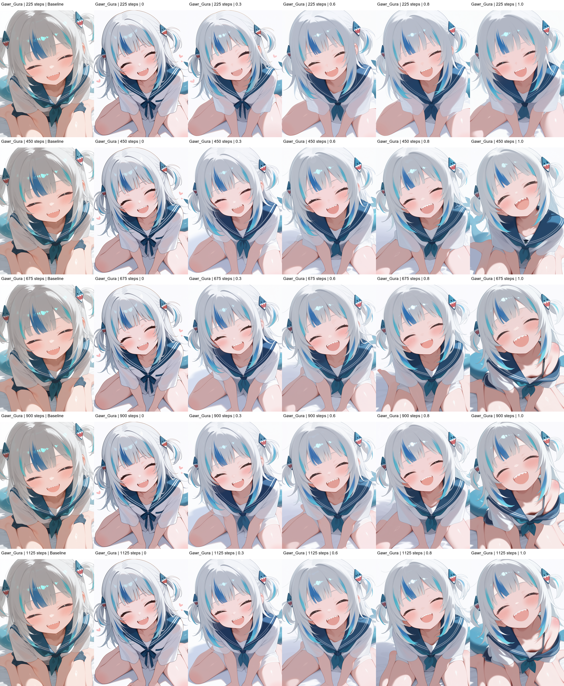

# LoRA 训练

这里记录 **Myon_style** 个人画风 LoRA 的训练进度与实际生成对比，重点展示效果，训练参数和问题记录另见对应文档。

## 当前进度

- **Myonstyle_v1**：2026-11-05 使用 Ostris AI Toolkit 完成首次正式训练（**1125 / 1125 Steps**）。
- **训练数据**：45 张图片与 45 份 Caption；保存了 225、450、675、900、1125 Steps 五个阶段的权重。
- **效果评估**：正在比较不同 Checkpoint 和 LoRA 权重；尚未选定最终发布版本。

## Myonstyle_v1 · Gura 效果对比

上图展示 **Gawr Gura** 在不同训练阶段、不同 LoRA 权重下的对照结果。初步观察认为，LoRA 学到了一部分萌系脸型、大眼睛与眼部高光，但与原画师串 + nyalia 的目标画风仍有差距，尤其是柔和轮廓线、头发前后层次和阴影细节。以上是个人视觉判断，**不是已量化验证的画风分数**。

后续优先检查并改善训练数据的构图与光照覆盖，再决定是否进行下一轮训练。

## 详细记录

- [训练配置、Checkpoint 与曲线](lora-training.md)
- [生成测试与画风评估](lora-evaluation.md)
- [数据集说明](lora-dataset.md)
- [实验问题及调整记录](lora-development-log.md)

训练素材、完整输出和 LoRA 权重保存在本地，当前不在 GitHub 发布。
