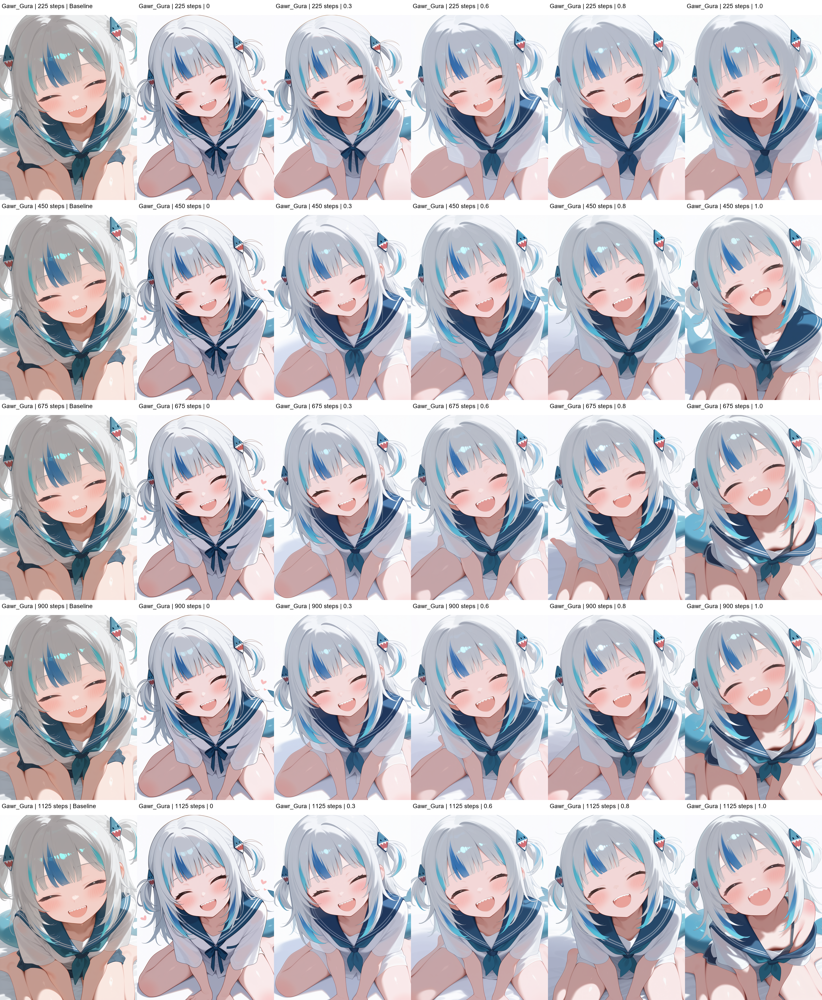

# Myonstyle v1｜对比评估

使用 NeoForge、WAI-Illustrious v15，对比训练的 **225 / 450 / 675 / 900 / 1125 Steps** 五个 LoRA。每个场景固定其余 Prompt、Seed、采样器、Hires.fix 和 ADetailer；只改变风格模块及测试权重。

- **Baseline：** 原画师串 + nyalia。
- **0：** 移除画师串及 nyalia，不加载 Myonstyle LoRA。
- **LoRA：** 完全替换原画师串及 nyalia，使用 `myonstyle` + 对应模型与权重。

原有 `shiny skin`、`blush` 等内容标签和完整 Negative Prompt 保留。Negative Prompt 中 EasyNegative LoRA 标签存在，但是否实际激活尚未核实。

## 第一轮：五个参考场景

Youmu / Reimu / Sakuya / Marisa / Sanae；对比 **Baseline / 0.7 / 0.8 / 0.9 / 1.0**。

**初步人工观察：** 萌系脸型、大眼睛及反光较明显，但部分头发、服装褶皱和阴影细节不足。高权重组之间的差异较小。这不能证明任何具体训练参数存在问题。

## 调整后的实验

权重范围调整为 **Baseline / 0 / 0.3 / 0.6 / 0.8 / 1.0**，以观察从无 LoRA 到较强 LoRA 的变化。

增加 **Yuuka（Blue Archive）、Gawr Gura（Hololive）、Hoshino（Blue Archive）** 三个训练角色名单之外的场景，检查同类动漫人物的跨角色风格迁移。是否未出现在实际训练样本中，以本地 Caption 核对为准。

## 第一轮训练结果与发现

这张图展示了 Gura 在五个训练阶段、不同 LoRA 权重下的生成效果。

从目前的结果来看，我的 LoRA 确实学到了一些画风特征，比如可爱的脸型、大眼睛和眼部反光。但和原始画师串相比，我觉得还原程度还不够。

我想保留的画风不只是人物可爱，还包括比较柔和、不那么硬朗的轮廓线，以及前发、后发之间明显的层次和阴影变化。目前模型在这些细节上的表现还不够理想。

我怀疑这和训练集有关。现有的 45 张图片大多是 Portrait，复杂构图、背景和不同光照的覆盖有限，可能让 LoRA 更容易学到面部特征，而没有充分学到其他画风细节。

所以我准备先调整训练集，再考虑第二轮训练，暂时不直接修改 Rank 或增加训练步数。

Codex 仅通过代码生成图片、校验参数及拼版；**画风评价由本人肉眼完成**。全部原始生成图与记录保存在本地；本页展示 Gura 对比图。
