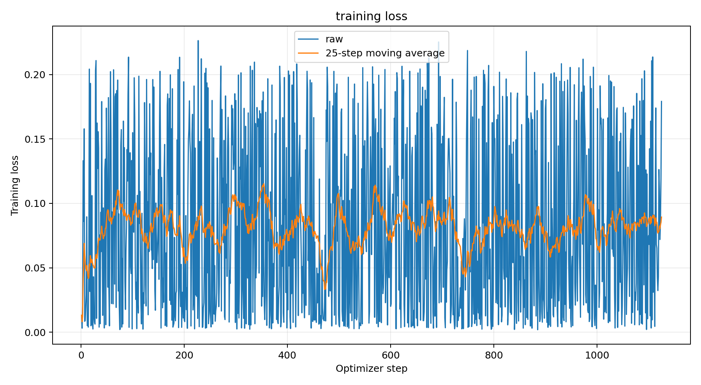
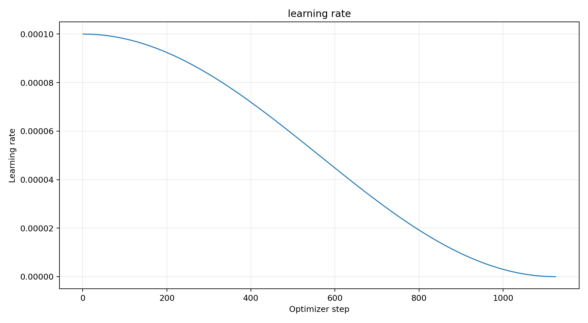
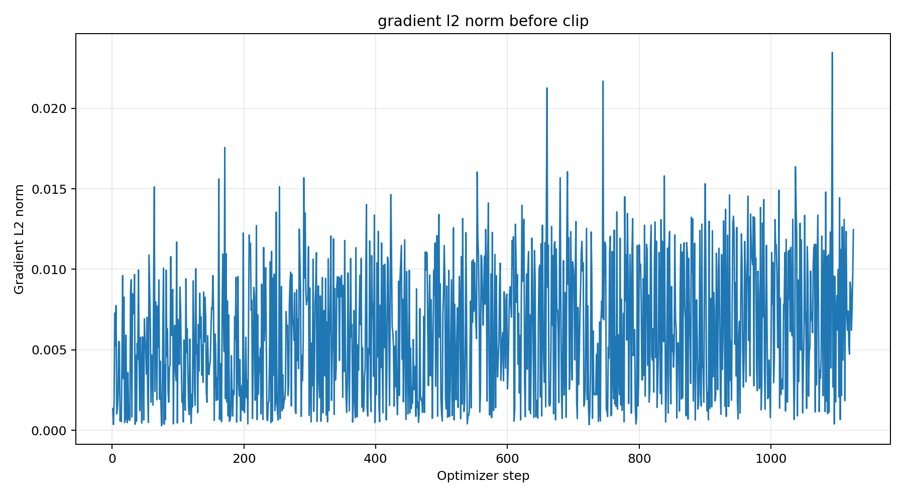
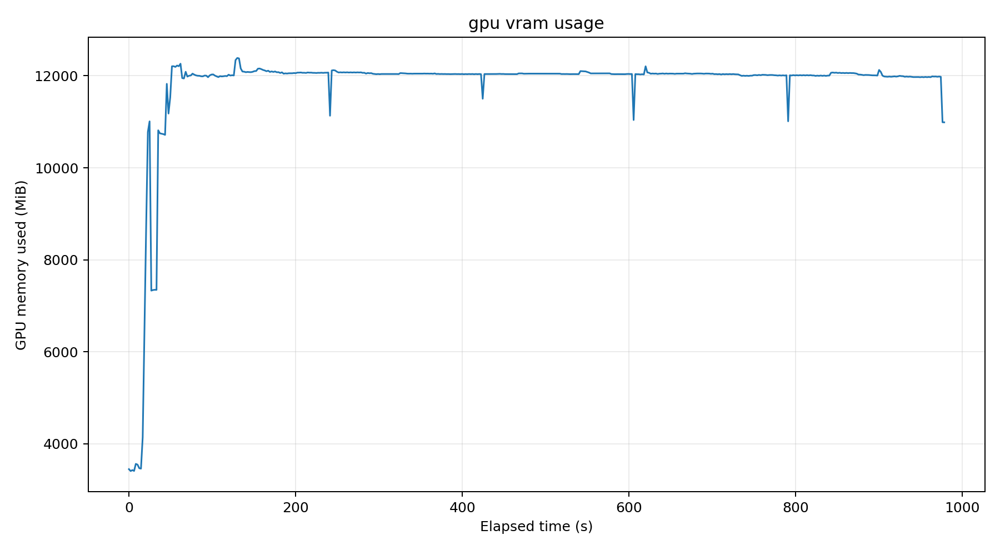

# Myonstyle v1｜训练记录

2026-11-05，使用 **Ostris AI Toolkit** 完成首次 SDXL 风格 LoRA 训练。目的是学习个人 Myon_style 画风，测试是否能替代原始画师串与 nyalia 的组合。

## 实际训练设置

| 项目 | 参数 |
| --- | --- |
| 工具 | Ostris AI Toolkit 0.13.41（`beb94824c51480a04d3c86c718603676fdef6938`） |
| 底模 | WAI-Illustrious v15（SDXL） |
| 数据集 | 45 图 + 45 Caption，触发词 `myonstyle` |
| 分辨率 | 1024，长宽比 buckets |
| Rank / Alpha | 32 / 16 |
| Batch / 梯度累积 | 1 / 1 |
| 优化器 / UNet 学习率 | AdamW8bit / `1e-4` |
| Scheduler / Precision | Cosine / BF16 |
| Text Encoder | 未训练 |
| Gradient Checkpointing | 开启 |
| Steps | **1125 / 1125** |

## 保存的权重

| Steps | 文件 |
| ---: | --- |
| 225 | `Myonstyle_v1_000000225.safetensors` |
| 450 | `Myonstyle_v1_000000450.safetensors` |
| 675 | `Myonstyle_v1_000000675.safetensors` |
| 900 | `Myonstyle_v1_000000900.safetensors` |
| 1125 | `Myonstyle_v1.safetensors` |

训练正常结束；1,125 个记录的 Loss 和梯度范数均为有限值。最终 Loss **0.179135**，采样到的整卡显存峰值约 **12,387 MiB**。Loss 波动及非单调的移动平均值本身不构成训练失败证据，也不证明视觉效果。

## 训练曲线

[初期 SD-Trainer 配置](../configs/myonstyle-v1-initial.toml)只是历史计划，**并非本次 AI Toolkit 的实际执行文件**。数据集见[数据集记录](lora-dataset.md)，测试见[对比评估](lora-evaluation.md)。模型权重与完整训练日志留在本地。
